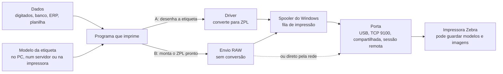

# Mapa de hipóteses

> **Nada aqui está confirmado.** São as explicações possíveis para como a empresa imprime as etiquetas, com o que confirmaria ou descartaria cada uma. O status muda conforme as evidências chegam.

## Os caminhos possíveis de uma etiqueta

Este é um modelo genérico de impressão no Windows, **não** o sistema da empresa. Serve para saber o que procurar.

- **Caminho A (gráfico):** o programa desenha a etiqueta como se fosse uma página, e o driver a traduz para ZPL. O resultado pode ter campos nativos ou virar uma imagem (`^GF`).
- **Caminho B (RAW):** o programa monta o ZPL sozinho e o envia pronto. O driver não converte nada.

Descobrir qual caminho a empresa usa é uma das perguntas centrais, porque muda o que uma solução própria precisaria reproduzir.

## Hipóteses

Elas não se excluem: H1 e H7 podem ser verdadeiras ao mesmo tempo, por exemplo.

| ID | Hipótese | O que confirmaria | O que descartaria | Onde olhar |
|---|---|---|---|---|
| H1 | Um **programa comercial de etiquetas** (ex.: BarTender, NiceLabel, ZebraDesigner, CODESOFT) desenha e imprime as etiquetas. | O programa aparece nas seções 2 e 3 do relatório e na janela "Sobre". | Nenhum programa de etiquetas instalado nem aberto. | Relatório da Etapa 1, seções 2 a 5 |
| H2 | O **ERP ou um sistema da empresa** gera o ZPL e o envia direto (caminho B). | A impressão sai de uma tela do ERP; a captura tem ZPL com campos nativos; a fila usa tipo de dados RAW. | A impressão sai de um programa de etiquetas separado. | Observação (Etapa 2); captura (Etapa 4) |
| H3 | Uma **planilha ou banco Access com macro (VBA)** monta e imprime as etiquetas. | Excel ou Access aberto durante a impressão; arquivos `.xlsm` ou `.accdb` em uso. | A impressão sai de outro programa. | Relatório, seção 3; observação (Etapa 2) |
| H4 | Um **sistema web** imprime por um serviço local (ex.: Zebra Browser Print, QZ Tray). | A impressão é feita pelo navegador; o serviço aparece nas seções 4 e 5. | Nenhum serviço desse tipo instalado. | Relatório, seções 3 a 5 |
| H5 | O programa **roda em outro computador** (Área de Trabalho Remota ou Citrix) e a impressora é redirecionada. | Sessão "RDP-Tcp" ou "ICA"; impressoras redirecionadas; portas `TS001`. | Sessão "Console" e programa instalado no próprio PC. | Relatório, seções 1 e 6 |
| H6 | O **modelo fica guardado na impressora** (`^DF`/`^XF`) e o computador envia só os dados. | A captura tem `^XF` e `^FN`. | As capturas trazem a etiqueta completa a cada impressão. | Captura (Etapa 4) |
| H7 | A etiqueta chega à impressora **como imagem** (`^GF`), gerada pelo driver. | Captura dominada por `^GF`, sem `^FD`. | Captura com textos e códigos de barras em `^FD`. | Captura (Etapa 4) |
| H8 | Os dados **vêm de outro sistema** (banco de dados, ERP, arquivo), não só da digitação. | Campos preenchidos sozinhos; o programa conecta a um servidor de banco ou lê arquivos de dados. | Todos os campos são digitados; nenhuma conexão nem arquivo de dados. | Pergunta E3; Monitor de Recursos (Etapa 3) |

## Como saber se o conteúdo é gerado no PC ou vem de outro sistema

1. **Observar o preenchimento** (sem risco): quais campos aparecem sozinhos depois que alguém digita um código? Isso indica uma consulta, mas não diz a quem.
2. **Ver as conexões do programa** (só leitura, ferramenta do próprio Windows): no Monitor de Recursos (`resmon`), aba **Rede**, seção **Conexões TCP**, filtrando pelo processo do programa. Portas comuns de bancos de dados: 1433 (SQL Server), 5432 (PostgreSQL), 3306 (MySQL/MariaDB), 1521 (Oracle) e 3050 (Firebird, comum em ERPs brasileiros). As portas 80 e 443 sugerem uma API ou um sistema web.
3. **Ver os arquivos abertos** (só leitura): no Monitor de Recursos, aba **CPU**, seção **Identificadores Associados**, pesquisando pelo nome do programa. Planilhas, arquivos `.mdb`/`.accdb`, `.csv` ou `.xml` são pistas.
4. **Comparar capturas** (Etapa 4): imprimir duas vezes mudando um único dado e comparar os arquivos. O que muda é variável; o resto é modelo.

Nenhum desses passos prova sozinho a origem dos dados. A conclusão vem do conjunto das evidências.

## Status

| ID | Status | Evidência | Atualizado em |
|---|---|---|---|
| H1 | aberta | — | — |
| H2 | aberta | — | — |
| H3 | aberta | — | — |
| H4 | aberta | — | — |
| H5 | aberta | — | — |
| H6 | aberta | — | — |
| H7 | aberta | — | — |
| H8 | aberta | — | — |

Legenda: **aberta** (sem evidência), **indício** (uma evidência a favor), **confirmada** (evidências suficientes), **descartada** (evidência contra).
